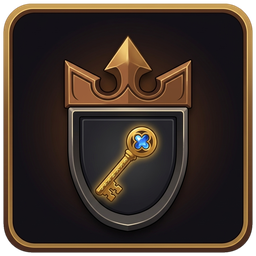

# Legacy Unlock

A tiny addon for **WoW Forever** that lets you open the **Legacy** window even if you have not earned any Legacy points yet.

## Why

On WoW Forever the Legacy window stays locked until your Legacy level is above 0: the micro menu button is greyed out and the key binding does nothing. The window itself works fine at level 0, so you can browse the challenges, the reward track and the tree before you earn your first point.

## What it does

- The **Legacy key binding** opens the window at Legacy level 0.
- The **Legacy micro menu button** is enabled at Legacy level 0 and opens the window.
- At level 0 the window opens on its Challenges tab; the other tabs are a click away.
- Once your Legacy level is above 0 the addon does nothing: the game's own behaviour takes over.

It only adds to Blizzard's functions with post-hooks (`hooksecurefunc`). Nothing of Blizzard's is replaced, and nothing runs in the background.

## Installation

Download the latest release and extract the `LegacyUnlock` folder into `World of Warcraft\_forever_\Interface\AddOns`.

## License

MIT. See [LICENSE](LICENSE).
